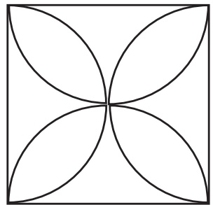
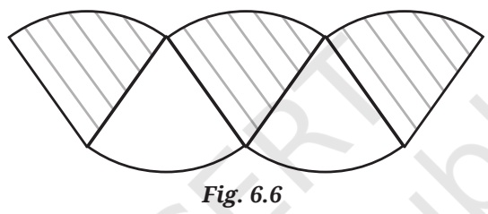
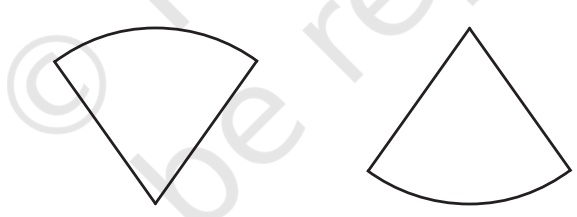
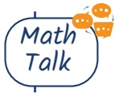
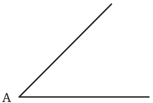

6. Construct the following figure.

How do we construct the petals so that they are of the maximum possible size within a given square?

**Repeating Units and Repeating Angles**

Construct the following figure.

In this figure, there is a single unit repeating itself. To construct this figure, we need to make exact copies of this unit in two different orientations.

In order to make exact copies, all the units must have the same arm lengths and the same angle between the arms. We can ensure equal arm lengths using a compass, but how do we ensure equal angles?

Let us develop a method to create an exact copy of a given angle.

Draw an angle. Create a copy of this angle using only a ruler and compass.

