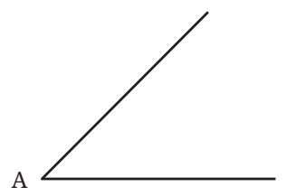
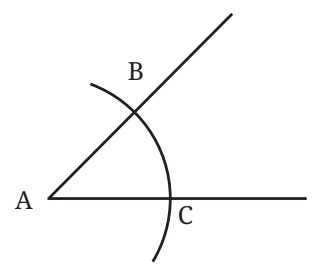
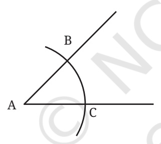
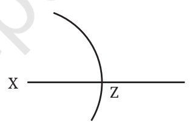
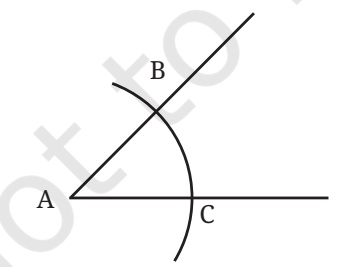
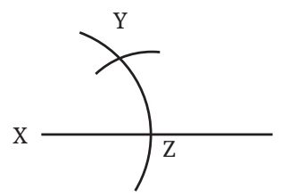

You might have developed your own method. Here is one simple approach.

**Steps of Construction to Copy an Angle**

1.

X

2.

X

Draw an arc from A.

This gives us three points that form the isosceles triangle ∆ABC.

3.

Draw an arc of the same radius from X.

4.

Measure BC using a compass. Transfer this length on the arc from Z to get $\mathrm { Y Z } = \mathrm { B C } .$