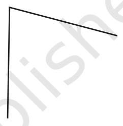
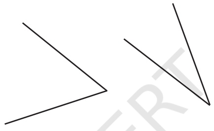
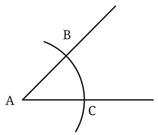
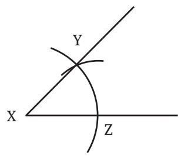
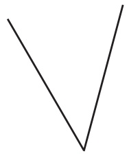
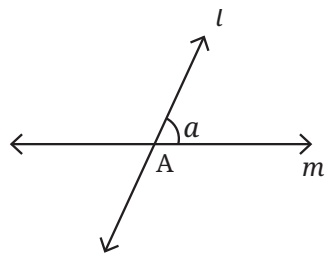
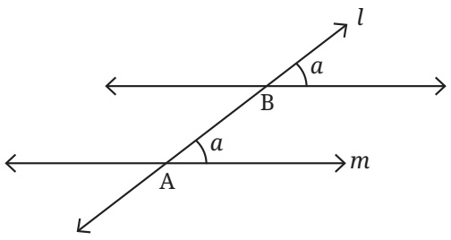

5.

By the SSS congruence condition, $\Delta \mathrm { A B C } \cong \mathrm { X Y Z } .$ . So, $\angle \mathrm{A} = \angle \mathrm{X}$

**Figure it Out**

1. Construct at least 4 different angles in different orientations without taking any measurement. Make a copy of all these angles.

2. Construct the Fig. 6.6.

This procedure to copy an angle finds an important application in constructing parallel lines using only a ruler and compass.

**Construction of a Line Parallel to the Given Line**

Recall that in the construction using a ruler and a set square, we constructed equal corresponding angles to get parallel lines.

How do we implement this idea using a ruler and a compass?

Suppose there is a line m to which we need to draw a parallel line. We construct a line l that intersects m. Line l will serve as a transversal to line m and to the line parallel to m that we are going to construct.

Let us choose a point B on l through which we are going to draw the parallel line. This parallel line must make the same corresponding angle, as shown in the figure. This can be done by copying the angle between m and l.

Fig. 6.7

