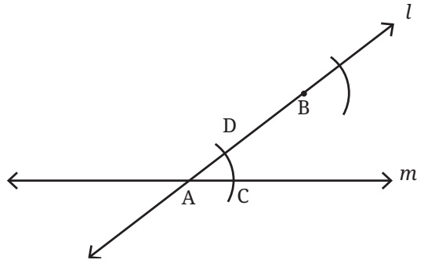
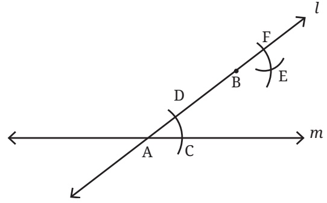
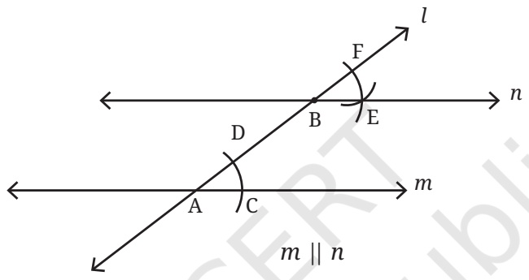
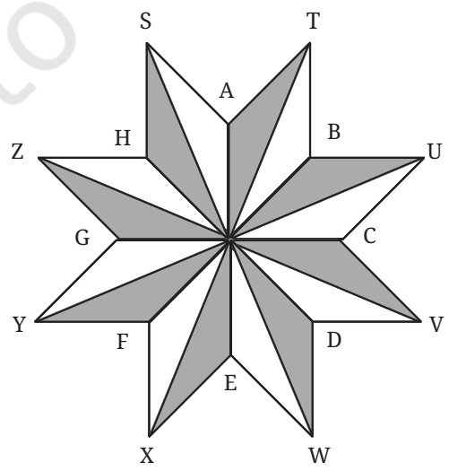

Here is a step-by-step procedure for carrying this out.

Fig. 6.8

Fig. 6.9

Construct arcs of equal radius from A and B

Transfer the length CD to the arc from F

Fig. 6.10

Figures 6.7–6.10 describe a method to construct a line parallel to the given line.

**Figure it Out**

1. Construct 4 pairs of parallel lines in different orientations.

2. Construct the following figure.

