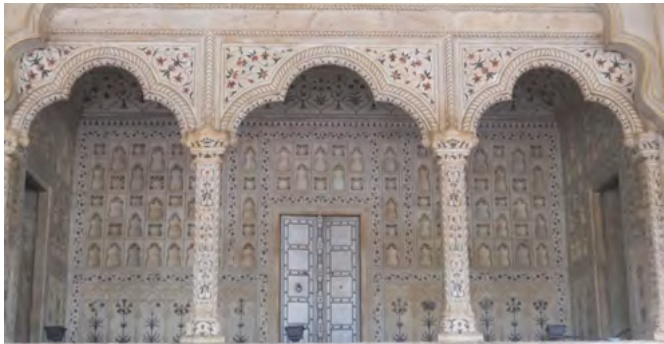
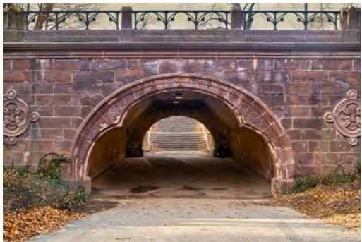
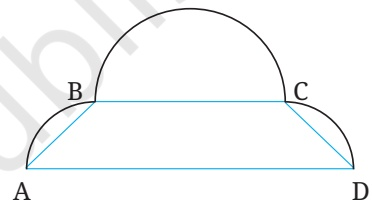
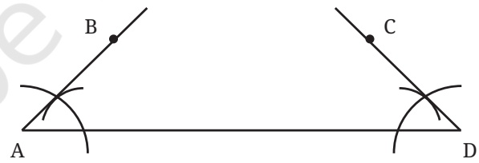

## Arch Designs

**Trefoil Arch**

Have you seen this kind of beautiful arch?

https://commons.wikimedia.org/w/index.php?curid=28374748Diwan-i-Aam, Red fort

https://commons.wikimedia.org/wiki/File:Central\_Park\_A.jpgCentral park, New York City

How did they make these arches?

The first step is to be able to draw them on a plane surface such as paper or stone.

Construct this arch shape on a piece of paper.

Let us think about the support lines this figure will need.

For symmetry, we should have $\mathrm{AB} \equiv \mathrm{CD}$ , and $\angle BAD = \angle CDA$ How would you construct these support lines?

Construct equal angles at A and D. Mark B and C such that AB = CD.

? Use these support lines to construct an arch. If required, adjust the radii of the arcs to make the arch look more aesthetically pleasing.