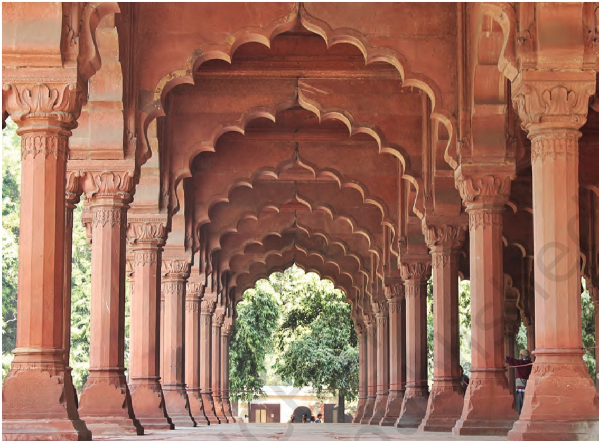
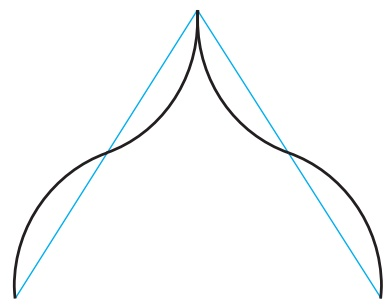
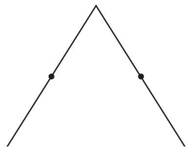

## A Pointed Arch Some arches look like this.

https://en.m.wikipedia.org/wiki/File:Diwan-i-Aam,\_Red\_Fort,\_Delhi\_-\_2.jpgDiwan-i-Aam, Red Fort

How do we construct this shape?

What supporting lines will you use to draw this arch?

Remember ‘Wavy Wave’ from the Grade 6 Textbook?

The supporting lines are just two line segments of equal length.

If their midpoints are marked, will you be able to construct a pointed arch?

Fig. 6.11