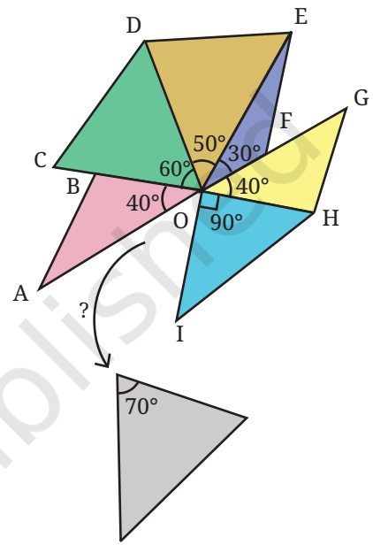
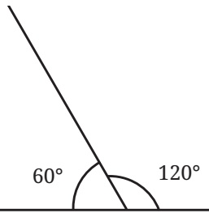

If six congruent equilateral triangles can indeed be placed as shown in Fig. 6.12, then the sides of the resulting hexagon are equal, and their angles are $60+60=120^{\circ}$ (how?). So what we really need to examine is whether 6 congruent equilateral triangles can fit this way without overlapping and without leaving any gaps around the centre.

We have defined a degree by taking the complete angle around a point to be $3 6 0 ^ { \circ }$ . So all the angles around the centre should add up to 360°.

? Consider this figure. Will the $7 0 ^ { \circ }$ angle fit into the gap? What is the gap angle ∠AOI?

We have,

$$
4 0 ^ { \circ } + 6 0 ^ { \circ } + 5 0 ^ { \circ } + 3 0 ^ { \circ } + 4 0 ^ { \circ } + 9 0 ^ { \circ } + \mathrm { g a p \; a n g l e } = 3 6 0 ^ { \circ } .
$$

Use this to determine whether the $7 0 ^ { \circ }$ angle fits the gap.

Thus, if there are angles that add up to 360°, their vertices can be joined together at a single point such that

(a) the angles do not overlap, and

(b) they completely cover the region around the point.

Since each angle in an equilateral triangle is 60°, six such angles add up to 360°. Therefore, six congruent triangles can be arranged as shown in Fig. 6.12.

? In Fig. 6.12 can you explain why AOD, BOE and COF are straight lines?

？ Construct a regular hexagon with a sidelength 4 cm using a ruler and a compass.

We can construct a regular hexagon more directly if we can construct a $1 2 0 ^ { \circ }$ angle using a ruler and a compass.

How do we do it?

This can be done if we can construct a $6 0 ^ { \circ }$ angle.

If we construct this,

we also get this.