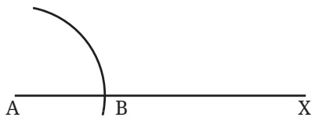
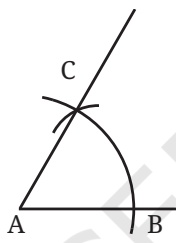
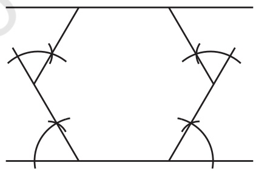

**Construction of a** $6 0 ^ { \circ }$ **angle**

How do we construct a $6 0 ^ { \circ }$ angle?

We get a $6 0 ^ { \circ }$ angle if we construct an equilateral triangle! We can use the following steps for this.

Suppose we need a $6 0 ^ { \circ }$ angle at point A on a line segment AX.

**Step 1**

Construct an arc with centre A and any radius.

**Step 2**

With the same radius, cut another arc from B that meets the first arc. Let C be the point at which the arcs meet.

We have $\angle CAX = 60^{\circ}$

Why is $\angle CAX = 60^{\circ}?$ Is there an equilateral triangle here? We can use these ideas to construct a regular hexagon —

Construct a regular hexagon of sidelength 5 cm.