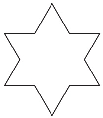
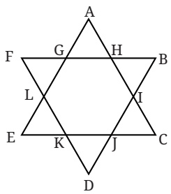
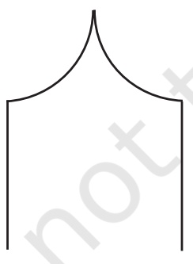
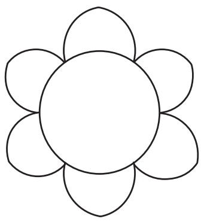

## Related Constructions

**Construction of** $\mathbf { 3 0 ^ { \circ } }$ **and 15° angles**

How will you construct $3 0 ^ { \circ }$ and $1 5 ^ { \circ }$ angles?

**6-Pointed Star**

Construct the following 6-pointed star. Note that it has a rotational symmetry.

**Hint:**

Do you see a hexagon here?

Are the six triangles forming the 6 points of the star — ∆AGH, ∆BHI, ∆CIJ, ∆DJK, ∆ELK, ∆FLG — equilateral? Why? [**Hint:** Find the angles.]

**Figure it Out**

1. Construct the following figures:

(a)

An Inflexed Arc

(b)

The fun part about this figure is that it can also be constructed using only a compass! Can you do it?