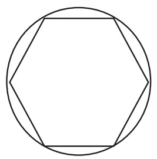
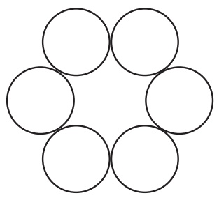
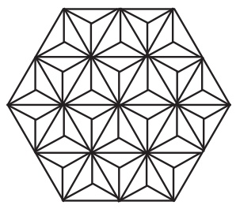
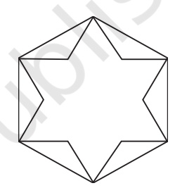
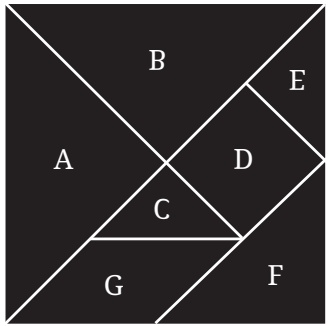

(c)

(d)

(e)

2. Optical Illusion: Do you notice anything interesting about the following figure? How does this happen? Recreate this in your notebook.

3. Construct this figure.

[**Hint:** Find the angles in this figure.]

4. Draw a line l and mark a point P anywhere outside the line. Construct a perpendicular to the given line l through P. [**Hint:** Find a line segment on l whose perpendicular bisector passes through P.]

## 6.2 Tiling

Tangrams are puzzles that originated in China. They make use of 7 pieces obtained by dividing a square as shown.

For the problems ahead, we need these 7 tangram pieces. These are provided at the end of the book. Or, by looking at the figure, you could make cardboard cutouts of the pieces.

