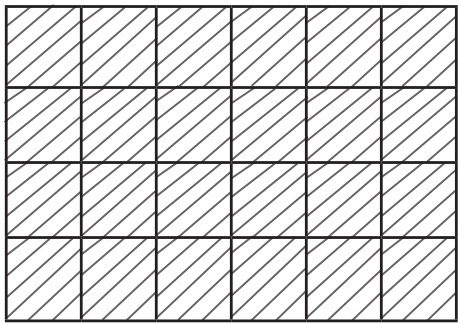
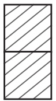
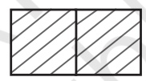
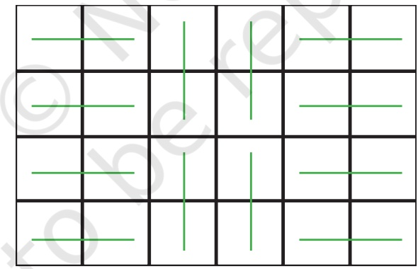

Covering a region using a set of shapes, without gaps or overlaps, is called **tiling**.

Consider a rectangu<u>lar grid made of unit square</u>s —

We call this a $4 \times 6$ grid, since it has 4 rows and 6 columns.

? Can a $4 \times 6$ grid be tiled using multiple copies of $2 \times 1$ tiles? We are allowed to rotate a $2 \times 1$ tile and use it.

Vertical tile

Horizontal tile

Here is one way.

Obviously, this is not the only tiling possible.

Can a $4 \times 7$ grid be tiled using $2 \times 1$ tiles?

What about a $5 \times 7$ grid?

To see that there is no way to tile a $5 \times 7$ grid using $2 \times 1$ tiles, observe that this grid has 35 unit squares. Each tile covers exactly 2 unit squares.