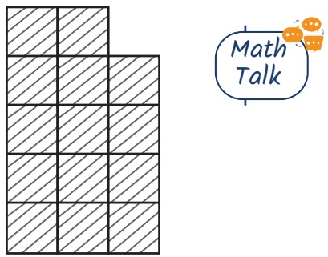
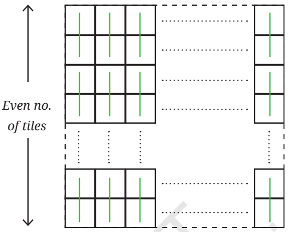
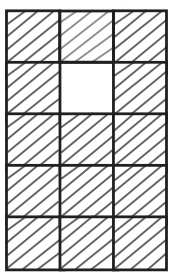

Complete the justification.

？ Is an m × n grid tileable with 2 × 1 tiles, if both m and n are even? If yes, come up with a general strategy to tile it.

One general strategy for this case is to cover each column with vertical tiles. This is possible because the number of rows is even.

? Is an $m \times n$ grid tileable with 2 × 1 tiles, if one of m and n is even and the other is odd? If yes, come up with a general strategy to tile it.

？ Is an $m \times n$ grid tileable with 2 × 1 tiles, if both m and n are odd? Give reasons.

Here is a $5 \times 3$ grid, with a unit square removed. Now, it has an even number of unit squares. Is it tileable with 2 × 1 tiles?

Is the following region tileable with $2 \times 1$ tiles?

