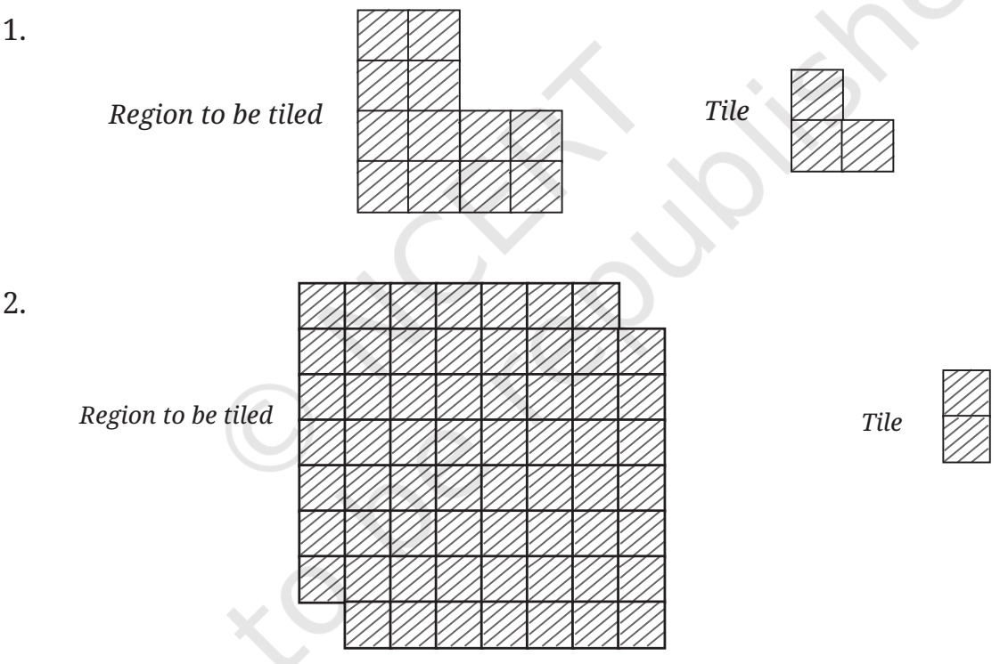

Is the black-and-white region in Fig. 6.14 tileable?

Any region tiled with black-and-white-tiles must have an equal number of black tiles and white tiles.

Since the black-and-white region in Fig. 6.14 has 8 white squares and 6 black squares, it can never be tiled with these tiles!

Use this idea to find another unit square that, when removed from a 5 × 3 grid, makes it non-tileable?

Isn’t it surprising how, by introducing colours and making the problem more complicated, it becomes easier to tackle? What a creative way of looking at the problem!

## Figure it Out

Are the following tilings possible?

1.

Region to be tiled

2.

## Tiling the Entire Plane

So far we have seen how to tile a given region. What about tiling the entire plane?

Can you think of a shape whose copies can tile the entire plane? Clearly, squares can.