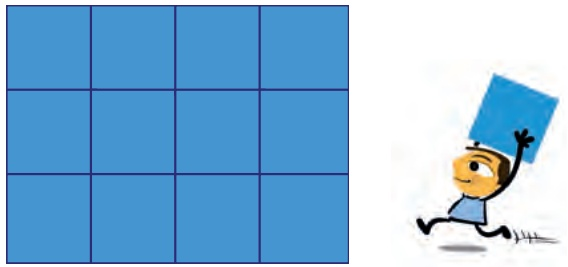
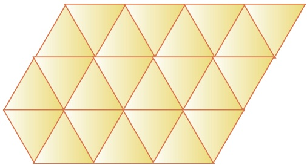
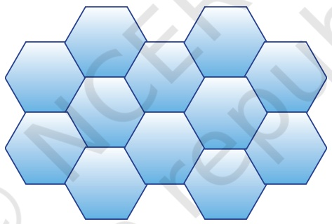
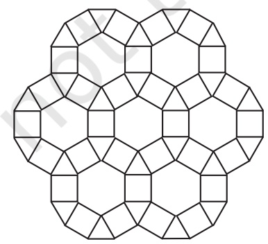
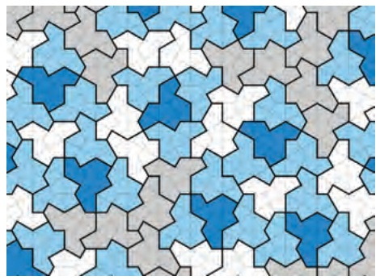

Are there other regular polygons that can tile the plane? What about equilateral triangles?

Tiling with equilateral triangles shows the possibility of tiling with another regular polygon.

A plane can be tiled using regular hexagons as well.

A plane can also be tiled using more than one shape, and using non-regular polygons. People such as the great Dutch artist Escher (1898 – 1972) — whose works explored mathematical themes such as tiling — have come up with creative ways of tiling a plane with animal shapes! Here are some examples.

(a)

(b)