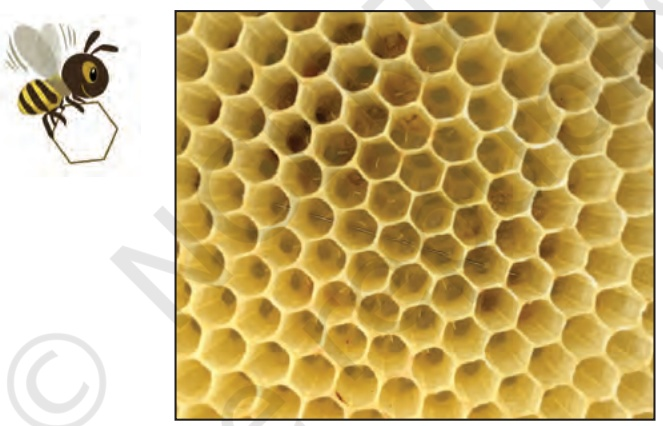
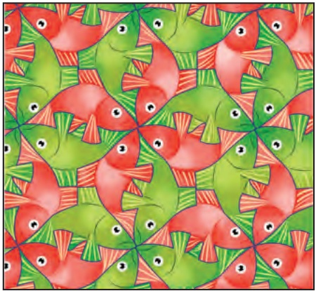
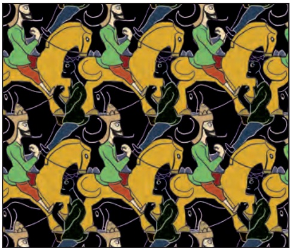

(c)

(d)

Mathematicians are still exploring various ways of tiling the plane! Tiling (b) was found as recently as 2023.

Have you seen tilings in daily life? They are often used in buildings and in designs. Tilings are found in nature too. The front face of bee hives and some wasp nests are tiled using hexagonal cells!

These cells are used by the insects to keep their eggs, larvae and pupae safe, as well as to store food. Because the region is tiled, no space is wasted.

Scientists still wonder how bees and wasps are able to make hexagonal cells. Next time you see any tiling, pay closer attention to it!

Tiling is still one of the most exciting and active areas of research in geometry.