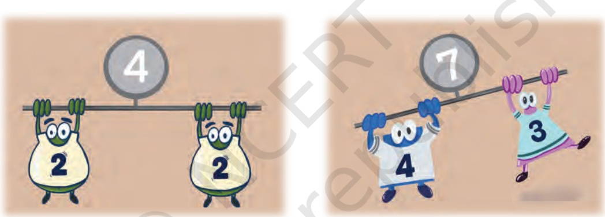
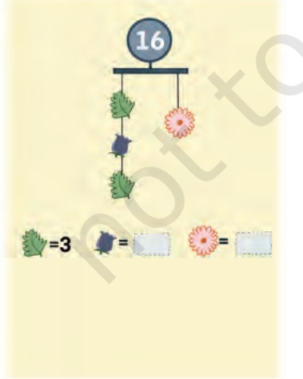
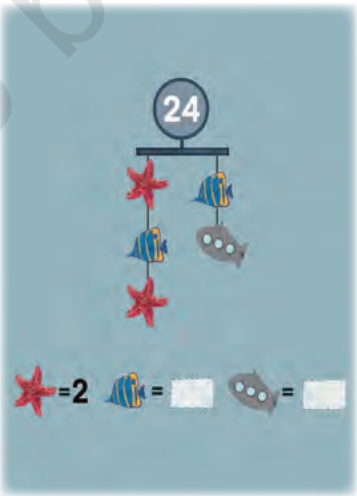
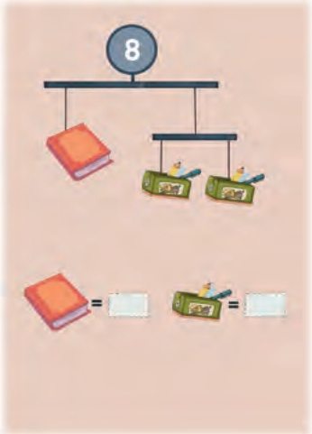

## 7.1 Find the Unknowns

## Unknown Weights

We have a weighing scale that behaves as follows. The numbers represent same units of weight:

Find the unknown weights in the following cases:

Fig. 7.1

Fig. 7.2

Fig. 7.3