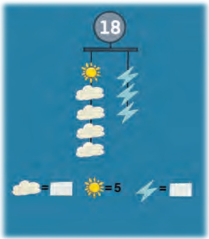
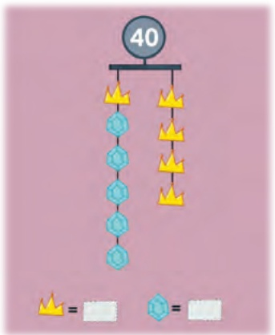
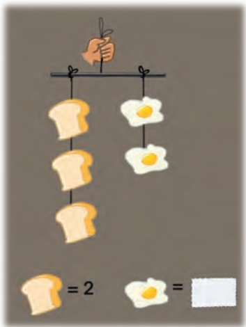
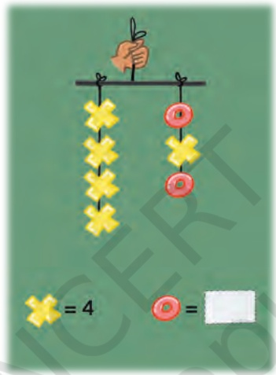
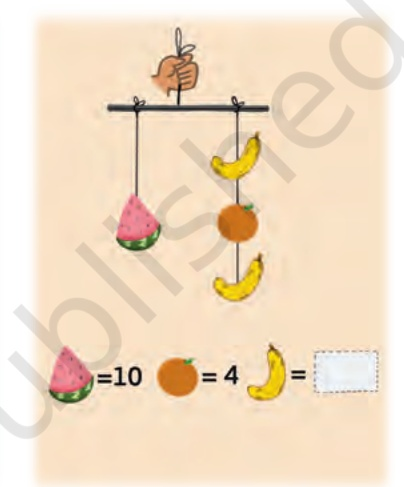
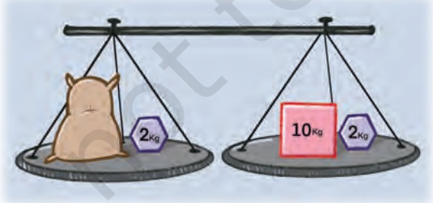
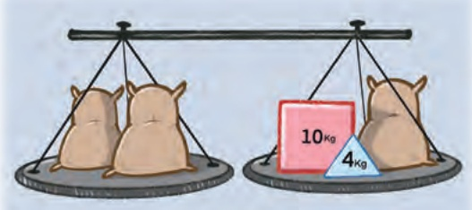

Fig. 7.4

Fig. 7.5

Fig. 7.6

Fig. 7.7

Fig. 7.8

Discuss the answers with your classmates. Give reasons why you think your answer is right.

? Find the unknown weight of the sack in the following cases. In Fig. 7.10, all the sacks have the same weight.

Fig. 7.9

Fig. 7.10

**[Hint:** If we remove equal weights from both the plates, will the weighing scale still be balanced? Remove one sack from each plate for Fig. 7.10.]