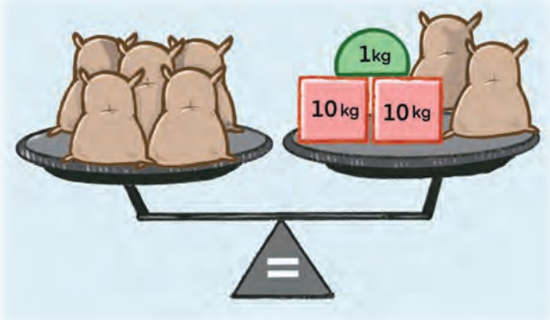
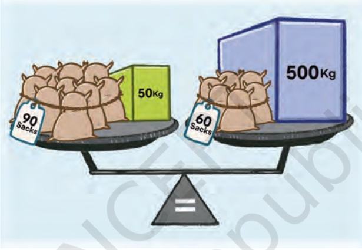
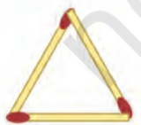
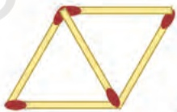
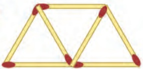
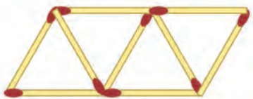

Fig. 7.11

[**Hint:** Can you remove objects so that the sacks are only on one plate?]

Fig. 7.12

**Note to the Teacher:** Encourage your students to find solutions to these problems using different strategies and methods, and ask them to compare and contrast their methods.

Let us find an unknown value in a different setting.

## Matchstick Pattern

Consider this sequence of matchstick arrangements.

1

2

3

4

Recall that we have studied this sequence in an earlier chapter.