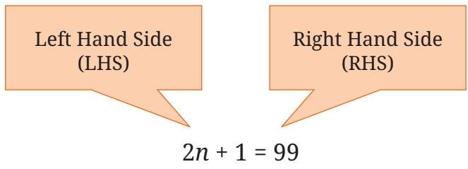

The figure shows the first 4 matchstick arrangements along with their position numbers in the sequence.

？ Jasmine decides to make a matchstick arrangement that appears in this sequence, using exactly 99 sticks. What will be the position number of this arrangement in the sequence?

To answer this question, it is useful to know the number of matchsticks in each position.

We see that

the arrangement at position 1 has $2 \times (1) + 1 = 3$ matchsticks, the arrangement at position 2 has $2 \times (2) + 1 = 5$ matchsticks, the arrangement at position 3 has $2 \times (3) + 1 = 7$ matchsticks, and so on.

So, the $n ^ { \mathrm { t h } }$ position will have $2 n { \scriptstyle + 1 }$ matchsticks.

To answer Jasmine’s question, we have to find the value of n such that $2 n + 1$ has the value 99, or,

$$
2n + 1 = 99.
$$

Can you find ways to get the value of $n ,$ such that $2n \div 1 = 99?$

? Is it possible to make a matchstick arrangement that appears in this sequence using exactly 200 sticks?

A statement of equality between two algebraic expressions is called an **equation**. Nowadays, when using symbols, we write an equation as two algebraic expressions with an equal sign ‘=’ between them.

Here are some more examples of equations:

$$
\begin{array}{c}3x + 4 = 7, \\20 = y - 3, \\\frac{a}{3} = 50, \\2z + 4 = 5z - 14\  etc .\end{array}
$$

The process of finding the value(s) of the letter−numbers for which the equality holds, or for which the value of the Left Hand Side (LHS) of the equation becomes equal to the Right Hand Side (RHS) of the equation,

is called **solving** the equation.

As we saw in the matchstick problem, framing an equation using an unknown quantity as a letter−number can help us find its value.

