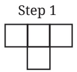
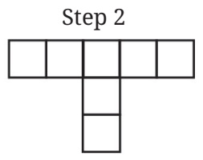
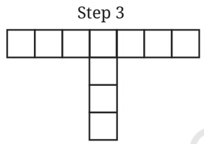
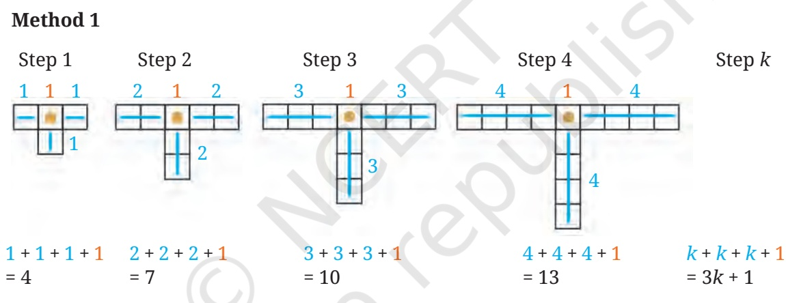
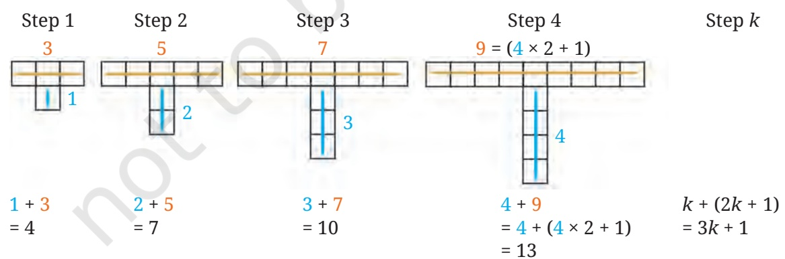

## Solving Problems

Forming and solving equations gives us the ability to find solutions to many problems in our lives. Let us see a few such examples.

? **Example 7:** Ranjana creates a sequence of arrangements with square tiles as shown below. Can she extend the sequence and make an arrangement using 100 tiles? If yes, which step in the sequence will it be?

She can look at the pattern in different ways. They are shown below.

## Method 1

## Method 2

