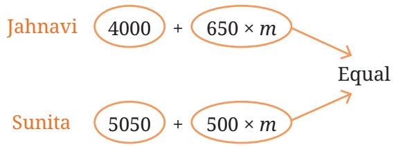

What are Sunita’s savings after m months?

| Mahesh represented the unknown quantity of the total number of people who can attend the party, including Madhubanthi and her family members, as p. Cost incurred = 25p + 50. Since this cost should be 500, we have the equation 25p + 50 = 500. Subtracting 50 from both sides, we get 25p = 500 - 50. 25p = 450. Dividing both sides by 25, we get p = 450 ÷ 25 = 18. 18 people can be at her party, including her 5 family members. That means 13 friends can be invited. | Srikanth decided to represent the unknown quantity of the total number of friends Madhubanthi can invite as f. What will be the cost in this case? Cost incurred = 25 (f + 5). Since Madhubanthi has ₹450 for snacks, we have the equation 25 (f + 5) = 450. Dividing both sides by 25, f + 5 = 18. Subtracting 5 from both sides, f = 13. |
| --- | --- |

? **Example 9:** Two friends want to save money. Jahnavi starts with an initial amount of ₹4000, and in addition, saves ₹650 per month. Sunita starts with ₹5050 and saves ₹500 per month. After how many months will they have the same amount of money?

Let m denote the number of months after which their savings are equal.

What are Jahnavi’s savings after m months?

As these amounts are equal after m months, we get the following equation:

$$
4000+650m=5050+500m
$$

4000 + 650 m – 500 m = 5050 (subtracting 500 m from both sides)

$$
4000+150m=5050
$$

$$
1 5 0   m = 5 0 5 0 - 4 0 0 0   ( \mathrm { s u b t r a c t i n g ~ 4 0 0 0 ~ f r o m ~ b o t h ~ s i d e s } )
$$