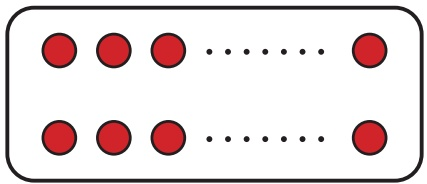
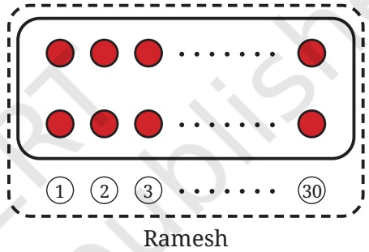

？ **Example 12:** Ramesh and Suresh have 60 marbles between them. Ramesh has 30 more marbles than Suresh. How many marbles does each boy have?

In this problem, we have two unknowns. If we denote the number of marbles with Ramesh as x and the number of marbles with Suresh as y, then what are the different equations that we have?

1. The total number of marbles is 60.

$$
x + y = 60.
$$

2. Ramesh has 30 marbles more than Suresh.

$$
x = y + 3 0 .
$$

Suresh

How do we find the unknowns using these equations? So far, we have only developed a strategy to solve an equation with one unknown! To get such an equation, we can do the following.

Denote the number of marbles with Suresh as y, and the number of marbles with Ramesh as y + 30.

Since the total number of marbles is 60, we have the equation:

$$
y+(y+30)=60
$$

$$
2y + 30 = 60.
$$

Use this to find both the unknowns.

## Generating Equations

So far, we have solved a given equation to find the value of the letter−number. Can we do the reverse — write equations using a given value of the letter−number?

？ Write equations whose solution is y = 5. Share the equations you made with each other and discuss the methods used.