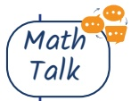

Two such equations are y + 1 = 6 and 3y = 15.

Consider the following chains of equations, where one is obtained from the previous one by performing the same operation on both sides.

$$
\begin{aligned} &\begin{cases}\\ &y + 1 = 6 \\&\begin{array}{l}\\ &  Multiplying    by   -1 \\&\end{array}\\ &- y - 1 = - 6 \\&\begin{array}{l}\\ & \begin{array}{l}\\ & \end{array}  Adding    y \\&\end{array} \\&- 1 = - 6 + y \\&\begin{array}{l}\\ & \begin{array}{l}\\ & \end{array}  Adding   6 \\&\begin{array}{l}\\ & \end{array} \\&5 = y \\&\end{array}\\ &\end{cases}\\ \end{aligned}
$$

$$
\begin{aligned} &3y = 15 \\&3y + 6 = 21 \\&\quad y + 2 = 7 \\&\quad \big | \quad  Subarcing   2 \\&\quad y = 5 \\&\quad y = 6\\ \end{aligned}
$$

? Can you form a chain going from the bottom equation to the top? Compare the operations used when going from the top to the bottom and from the bottom to the top.

Without calculating, can you find the value of the unknown in each equation in the chains above?

[**Hint:** We have seen that the value that satisfies an equation also satisfies the new equation obtained by performing the same operation on both sides of the original equation.]

？ **Example 13:** Can you give a real-life situation that can be modelled as the equation, 100x + 75 = 250?

**Solution:** If we think of these numbers as representing money, we can see that the total money is ₹250.

There are two terms that are adding to ₹250. The second term in the LHS, ₹75, is fixed and does not change. The value of the first term would change based on ${ } ^ { \circ }   X ^ { \flat }   ,$ . So we can think of 100 as the number of units and ‘x’ as the cost per unit. For instance, x could represent the cost of a plate of snacks and 75 could be the delivery charge.