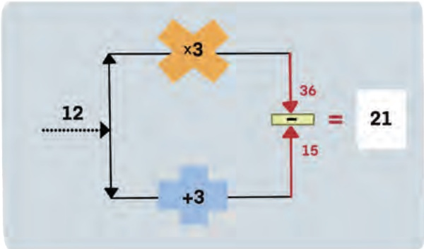
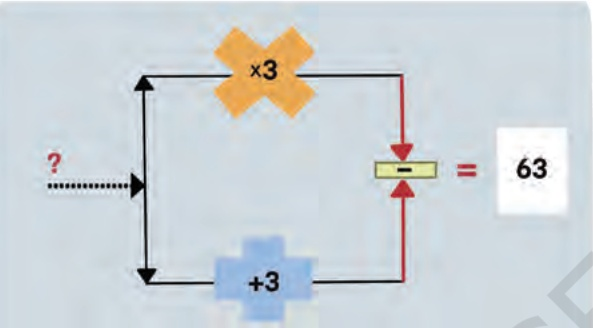
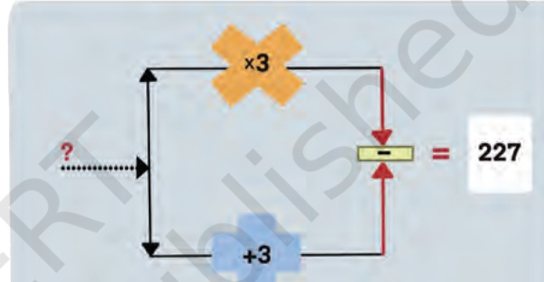
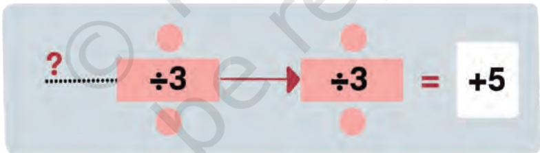

(b)

Find the inputs in the following cases:

5. What are the inputs to these machines?

6. A taxi driver charges a fixed fee of ₹800 per day plus ₹20 for each kilometer traveled. If the total cost for a taxi ride is ₹2200, determine the number of kilometres traveled.