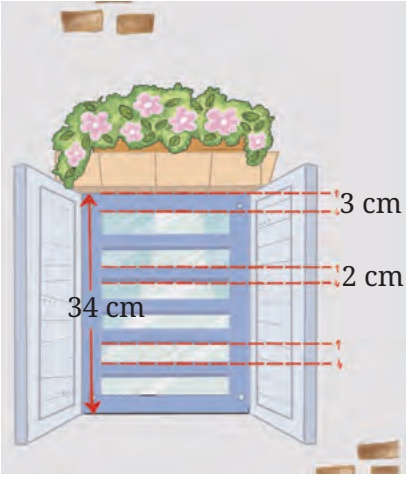
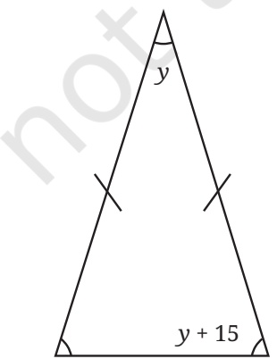
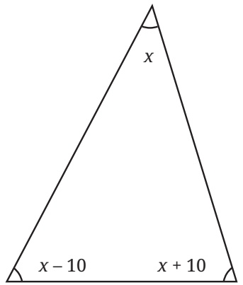

7. The sum of two numbers is 76. One number is three times the other number. What are the numbers?

8. The figure shows the diagram for a window with a grill. What is the gap between two rods in the grill?

9. In a restaurant, a fruit juice costs ₹15 less than a chocolate milkshake. If 4 fruit juices and 7 chocolate milkshakes cost ₹600, find the cost of the fruit juice and milkshake.

10. Given 28p – 36 = 98, find the value of 1 $1 4 p - 1 9$ and 28p – 38.

11. The steps to solve three equations are shown below. Identify and correct any mistakes.

(a)

$$
6 x + 9 = 6 6 ^ { 1 1 }
$$

(b)

$$
14y + 24 = 36
$$

$$
x + 9 = 11
$$

(c)

$$
4x - 5 = 9x + 8
$$

$$
7y + 12 = 18
$$

$$
4x = 9x + 8 - 5
$$

$$
x = 11 - 9
$$

$$
\mathcal { V } = 6
$$

$$
x = 2
$$

$$
4x = 9x + 3
$$

$$
\frac { 1 } { 2 } = \frac { 6 } { 7 }
$$

$$
4x - 9x = 3
$$

$$
- 5 x = 3
$$

$$
x = { \frac { - 5 } { 3 } }
$$

12. Find the measures of the angles of these triangles.

