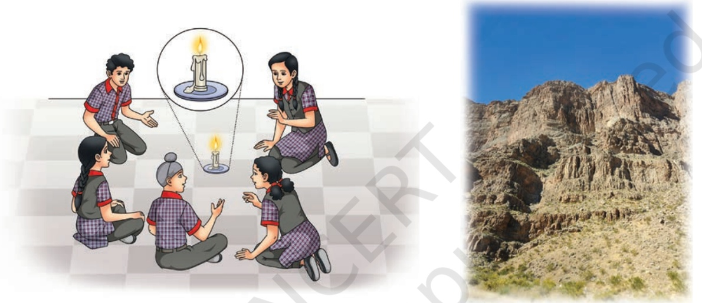
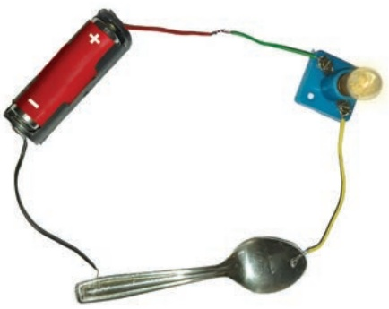
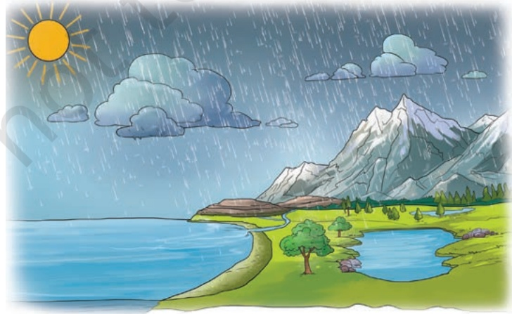

We then move on and play with some electric batteries, lamps and wires to try to find other kinds of properties of materials. What kind of materials do we need to make a lamp glow? This will lead us to classifying materials based on their properties — and we will enter the world of metals and non-metals. We know from our experience that a torch battery runs out eventually, and can’t be used

again. We’ll explore what kind of changes happen around us. Some changes can be reversed and others cannot be reversed.

Batteries run out, ice melts into water, fruits ripen, rocks break into pebbles… what kind of changes are these? Some of these happen, or happen faster, when things are heated. We will look at how heat flows — whether it is the melting of an ice cube in a glass, or the melting of a glacier. Water is, of course, everywhere, and with the heat from the Sun, it evaporates from the seas and falls as rain, perhaps trickling down into the ground, somewhere far away.

