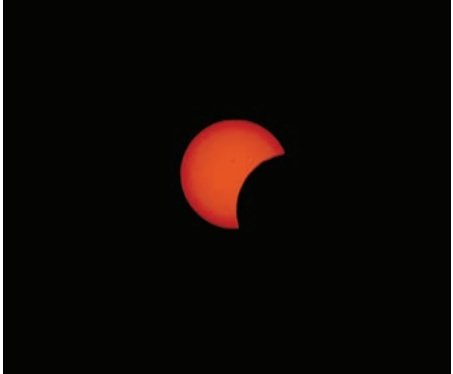
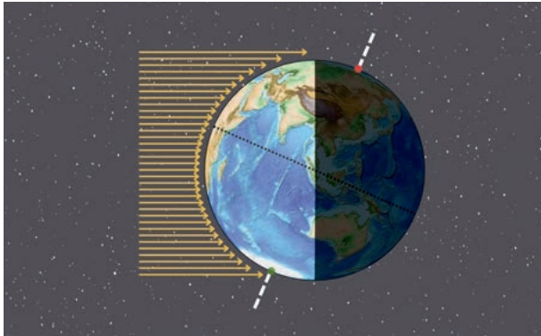
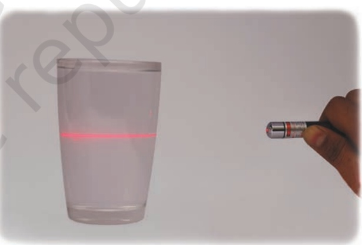

of light has given us a very deep understanding of the universe we live in. While we’ll perhaps learn about it only later, light and shadows are not just limited to things around us at home.

Even the Earth and the Moon can cast shadows, leading to the fascinating phenomena of eclipses. And of course, we have day and night that depend on receiving light from the Sun. To understand all of this, we need to know how the Earth rotates around its axis, how the Moon goes around the Earth, and the Earth around the Sun. And the consequences of these movements on life on our beautiful planet. While all this might have your head spinning, think about it. Isn’t it amazing that we humans can wonder about the wonderful world we live in?

In the chapters that follow, you’ll also make simple observations and do fun experiments, and dive into topics that need careful thinking. Each chapter builds on what you already know and encourages you to ask questions, explore, do handson experiments, and think like a scientist! As you will find out, even those experiments that seem to confirm what we think will happen, might lead to some additional questions that might need more experiments and more questions.

## 1.1 Happy Exploring!

## Activity 1.1: Question the Answer

In school or during tests, you’re usually given questions and expected to find the answers. But let’s turn that around! To think