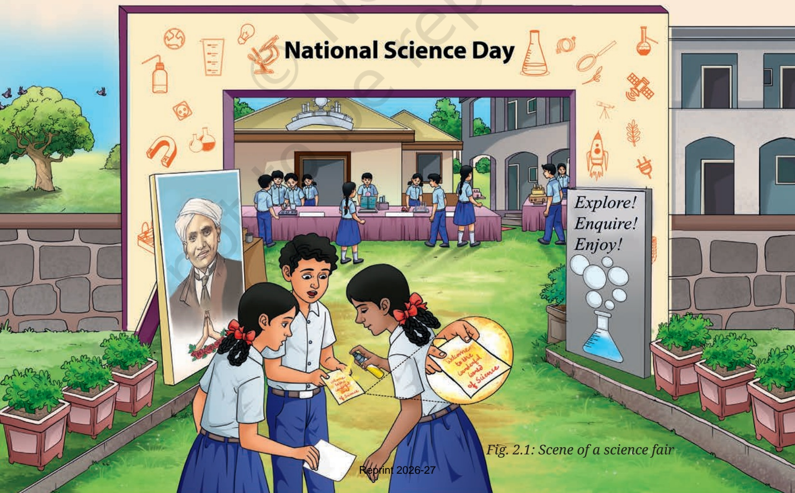

On 28 February, the school hosted a science fair to celebrate National Science Day. At the entry gate, siblings Ashwin and Keerthi were greeted with a white sheet of paper. They were curious to know why a white sheet of paper was given to them!

A few steps ahead, there was a volunteer spraying a liquid on these sheets of paper. The siblings also got their white sheets sprayed. To their surprise, the words ‘Welcome to the Wonderful World of Science’ appeared on the papers the moment the liquid was sprayed (Fig. 2.1). They were excited and eager to know how this happened and the **reason** behind it.

Their curiosity was partly satisfied at the ‘Colourful World of Substances’ stall. They saw many activities showing colour changes on mixing different substances. They decided to **explore** these changes further. Let us join them on this learning adventure.

0777CH02

