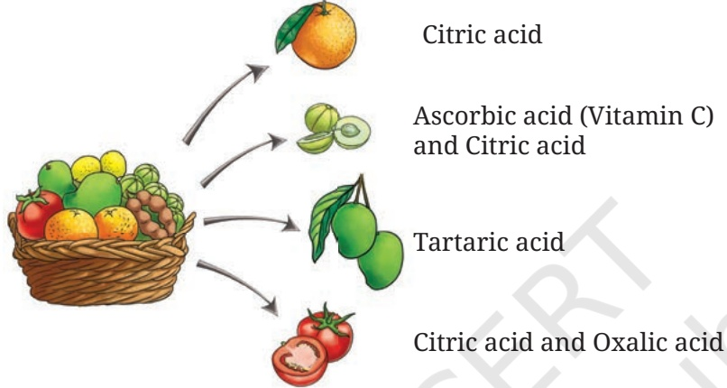

## Activity 2.2: Let us relate and explore

Are all the substances in Group A of Table 2.2 edible? Have you ever tasted these edible substances? Can you recall their taste? You will find that all these substances taste sour. Thus, we can say that substances that taste sour tend to contain **acids** and are acidic in nature.

**Caution** — Do not taste anything until asked to do so. Do not taste any unknown substance.

Some common edible substances and the names of the most common acids present in them are given in Fig. 2.4.

Fig. 2.4: The most common acids present in some edible substances

Find out and write the names of the most common acids present in the following substances —

Lemon\_ \_\_\_\_\_\_\_, Curd\_\_\_\_\_\_\_\_, Tamarind\_\_\_ \_, Vinegar

Now, let us take one of the substances — baking soda solution — from Group B. Rub the baking soda solution between your fingers. What do you observe?

It feels soapy or slippery. Basic substances are generally slippery to touch.

Also, **bases** generally taste bitter, but everything that tastes bitter may not contain a base. For example, bitter gourd (karela) possesses a bitter taste but is not basic in nature.

Now, I can check the nature of floor cleaning liquid using an indicator!

If litmus is not available, are there some other natural substances that can serve as acid-base indicators?