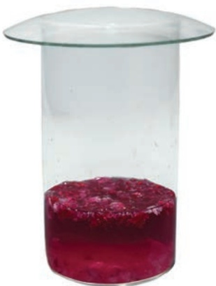
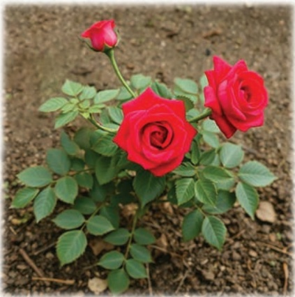
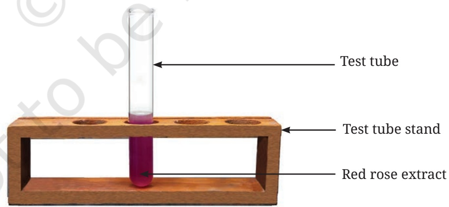

## 2.1.2 Red rose as an indicator

You might have observed many coloured flowers in your surroundings. Try making your indicators using these flowers.

Fig. 2.6: Red rose petals immersed in hot water

## Activity 2.3: Let us prepare

Collect some fallen petals of red roses available in your surroundings (Fig.  2.5). It is advised not to pluck flowers. You may pick petals or flowers fallen on the ground.

Take a fistful of the collected petals of red roses and wash them with water.

Crush the petals using a mortar and pestle.

Place them in a glass tumbler.

Fig. 2.5: Red roses

Pour some hot water into the glass tumbler to ensure that the crushed flower petals are completely immersed.

**Caution** — Perform this step under the supervision of an adult.

Cover the glass tumbler with a lid. Wait for 5 – 10 minutes till the water becomes coloured (Fig. 2.6), and filter it.

The filtrate (liquid after filtration) is the required flower extract (Fig. 2.7) to be used as an acid-base indicator.

Fig. 2.7: Test tube containing the red rose extract

## Activity 2.4: Let us fi nd out

Place 10 – 20 drops of the prepared red rose extract in each of two small transparent bottles or test tubes. Mark them A and B.