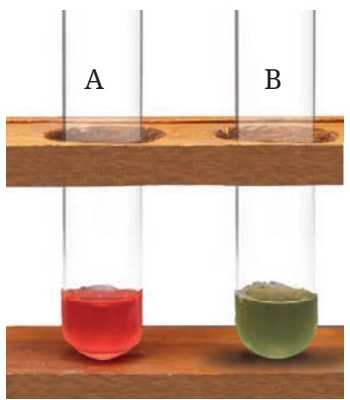

Add 20 – 30 drops of lemon juice in test tube A and 20 – 30 drops of soap solution in test tube B with the help of droppers.

Observe and record any colour changes (Fig. 2.8) to the extract in Table 2.3.

Repeat the same with the other samples used in Activity 2.1 and record your observations in Table 2.3.

Fig. 2.8: The changes in colour of the red rose extract on adding lemon juice (A) and soap solution (B)

Table 2.3: Testing the nature of samples with the red rose extract

| S.No. | Name of the sample | The colour of the red rose extract after adding the sample | Nature of the substance |
| --- | --- | --- | --- |
| 1. | Lemon juice |  |  |
| 2. | Soap solution |  |  |
| 3. | Amla juice |  |  |
| 4. |  |  |  |

Discuss your observations with your classmates.

Are the samples that change the colour of the flower extract to a shade of red the same as those that changed the colour of blue litmus paper to red? (Group A, Table 2.2)

Are the samples that change the colour of the flower extract to a shade of green the same as those that changed the colour of red litmus paper to blue? (Group B, Table 2.2)

Are the samples that do not change the colour of the flower extract the same as those that did not change the colour of red and blue litmus papers? (Group C, Table 2.2)

From the above activity, we can **conclude** that the red rose extract can also be used to test the nature of the substances; hence, it is another example of an acid-base indicator. We can conclude that the red rose extract seems to give red colour in an acidic solution and green colour in a basic solution.

Can you now fill in the nature of the substances in Table 2.3?