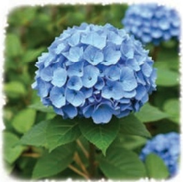
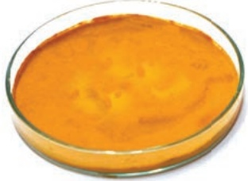

We are sure that you will be excited about the above results. You may repeat the process of preparing the extract and testing substances with some vegetables, fruits, or flowers, such as beetroot, purple cabbage, turmeric, Indian blackberry (jamun), and red hibiscus (gudhal) flower. They can also act as acid-base indicators.

## FASCINATING FACTS

Hydrangea is a plant that grows in cooler climates in the Himalayan region and the North-eastern states. It gives flowers of different colours, depending on the nature of the soil. Acidic soil produces bluecoloured flowers, whereas in basic soil, the flowers are

Hydrangea flowers

pink or red. Can gardeners alter the colour of hydrangea flowers bypink or red. Can gardeners alter the colour of hydrangea flowers by adjusting the acidic or basic nature of the soil?

## 2.1.3 Turmeric as an indicator

We have used blue and red litmus paper strips in Activity 2.1. Can you also make paper strips with some other natural indicators? Find out by performing the following activity.

## Activity 2.5: Let us prepare

Take a spoonful of turmeric (haldi) in a petri dish or container and add a little water to make a paste (Fig. 2.9a). You may also grind a piece of fresh turmeric.

Carefully dip a piece of filter paper in the turmeric paste until it gets yellow colour.

Take it out and allow it to dry.

Cut this yellow paper into thin strips, which are used as ‘turmeric paper’ (Fig. 2.9b).

**Caution** — Perform this step under the supervision of an adult.

(a) Turmeric paste

(b) Turmeric paper strips

Fig. 2.9: Preparing turmeric paper