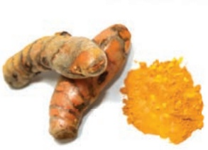

Using a dropper, put a drop of each of the samples used in Activity 2.1, one by one, on separate pieces of turmeric paper.

Record your observations in Table 2.4.

Table 2.4: Testing the nature of samples with turmeric paper

| S.No. | Name of the sample aTfhteer c poulotutirng of a t dhreo tpur omf tehreic s pamappelre |
| --- | --- |
| 1. | Lemon juice |
| 2. | Soap solution |
| 3. | Amla juice |
| 4. | … |

What did you observe?

Do all samples change the colour of the turmeric paper?

Group the samples which do not change the colour of the turmeric paper.

**Compare** them with the samples in Group A, Group B, and Group C in Table 2.2.

Can turmeric paper be used as an indicator for acidic substances? Discuss your I got a curry stain on my white shirt and on applying soap it changed its colour! Wow! Now I know the reason.

observations with your classmates.

Based on the observations, we can conclude that turmeric paper can be used to test basic substances. However, it cannot differentiate between acidic and neutral substances.

## FASCINATING FACTS

Why is turmeric known as a ‘Golden’ spice?

Turmeric is a member of the ginger family, which is grown in India and other countries. A common spice in daily households, it is being researched for benefits beyond the taste and colour it provides to the food! In the Ayurvedic system of medicine, turmeric is considered to have numerous health benefits, and is commonly used in several traditional home remedies.

Turmeric (Haldi)