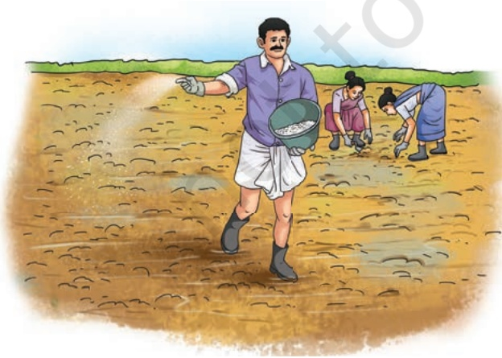

Initially, when a drop of blue litmus solution is added to the lemon juice solution, the colour of the solution turns red. When lime water is added to this test tube, the colour of the solution eventually changes from red to blue. This shows that the solution in the test tube is no longer acidic. Lime water has neutralised the effect of the acid.

When the solution of an acid is mixed with the solution of a base in sufficient quantity, we find that the resulting solution is neither acidic nor basic. Such reactions are called **neutralisation** reactions. In a neutralisation reaction, **salt** and water are formed with the evolution (i.e., release) of heat.

Acid + Base → Salt + Water + Heat

There are many examples in everyday life where you can observe the use of neutralisation processes. Let us find out!

Fig. 2.11: Stinging eff ect of an ant bite

## 2.3 Neutralisation in Daily Life

**Situation 1:** Keerthi was observing a butterfly in the garden with her hand resting on a tree trunk. Suddenly, a red ant bit her, leaving her skin red with stinging pain (Fig. 2.11). Her brother helped her by applying moist baking soda to the affected area, which relieved the pain. What do you think might be the reason for this?

When an ant bites, it injects an acidic liquid (formic acid) into the skin. The effect of the acid can be neutralised by rubbing moist baking soda, which is a base.

Fig. 2.12: Neutralising the acidic nature of soil

What remedies do people use to treat ant bites in your region?

**Situation 2:** On the Farmer’s Portal (an online platform from the Department of Agriculture, Cooperation and Farmers Welfare), a query from a farmer states, “My plants are not growing well lately”. After a detailed discussion, it was found that the excessive use of chemical fertilisers (substances added to soil to help plants grow better) made the soil acidic. What remedy might be provided to him?

When the soil is too acidic, the plants do not grow well. It can be treated with lime, which is a base. (Fig. 2.12).