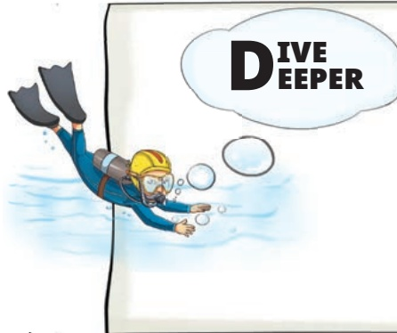

Aman accidentally spilt vinegar on some pieces of an eggshell or marble and noticed bubbling. He then poured a soap solution on another piece of eggshell or marble, but no bubbles appeared. Why did bubbles occur with vinegar but not with soap solution?

## Exploratory Projects

Create rangoli using acidic or basic substances and natural indicators.

You may discuss in your class the acidic, basic, or neutral nature of water obtained from various sources. You may like to test the water samples available from sources such as rain, taps, rivers, etc.

Collect a soil sample of your area and find out whether it is acidic, basic, or neutral in nature.

