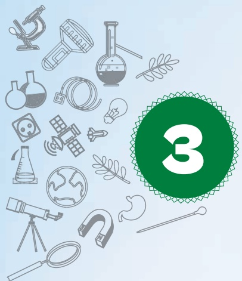
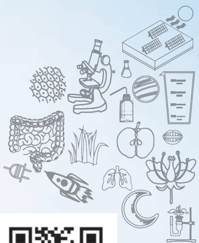
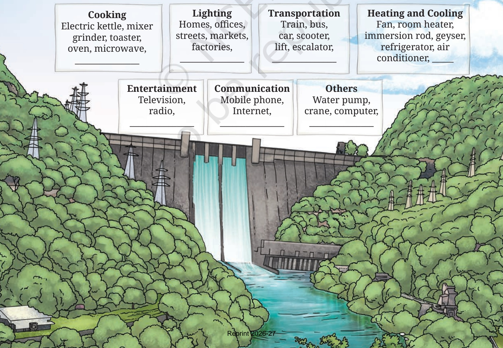

# Electricity: Circuits and their Components

Nihal and his classmates were excited for their school trip to the Bhakra Nangal Dam. There they would visit the hydroelectric power house where the force of falling water was used to generate electricity. They also looked forward to the free 13 kilometretrain ride from Nangal in Punjab to Bhakra in Himachal Pradesh, along the beautiful Sutlej river and through the Shivalik hills.

0777CH03

Prior to the trip, Nihal and his classmates were given a group assignment to prepare a presentation on the uses of electricity. They began by looking around their houses, then their school, followed by their neighbourhood, their city, and finally they searched the internet. To their astonishment, their list kept growing. They decided to organise the uses under different headings.

**Cooking** Electric kettle, mixer grinder, toaster, oven, microwave,

**Lighting** Homes, offices, streets, markets, factories,

**Transportation** Train, bus, car, scooter, lift, escalator, **Heating and Cooling** Fan, room heater, immersion rod, geyser, refrigerator, air conditioner,

**Entertainment** Television, radio,

**Communication** Mobile phone, Internet,

**Others** Water pump, crane, computer,

