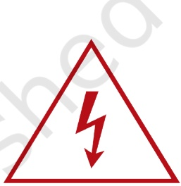

Can you help Nihal by adding some more uses to his lists? Also, suggest some other ways of grouping the uses of electricity.

We use electricity all the time, so let us learn something more about electricity. You have learnt earlier that electricity is generated in multiple ways — by windmills, by using wind energy, by solar panels capturing the Sun’s energy, by falling water and by using natural gas or coal (in the chapter ‘Nature’s Treasures’ in the Grade 6 Science textbook Curiosity). The electric supply from these sources reaches our homes and factories via wires. For example, at home we plug in various devices to the electrical sockets in the wall. However, to learn about electricity, we will focus on a portable source of electricity that most of us may have used. Let us start with its use in a common device like a torchlight.

**Caution**— The danger signs on electric poles and other appliances warn people that electricity can be dangerous if not carefully handled. Never ever perform experiments with power supply at your home or school. Even electricity from portable generators can be dangerous. Use only batteries or cells, like those in torchlights, wall clocks, radios, or remotes, for experiments with electricity.

## 3.1 A Torchlight

You might have used a torchlight, also called a torch or a flashlight.

**Activity 3.1: Let us explore**

Fig. 3.1: A torchlight

™ Take a torchlight similar to the one shown in Fig. 3.1.

™ **Observe** it carefully. Do you notice a lamp? And a switch?

™ Slide its switch and observe. Does the torch lamp glow?

™ Now slide the switch back to its original position and observe the torch lamp.

You might have noticed that in one position of the switch, the torch lamp glows and in the other position the lamp does not glow.

™ Now, open the torchlight. What do you find inside?

Inside the torchlight, you may find two or more electric cells.

Why does the torch lamp glow in one position of its switch?

