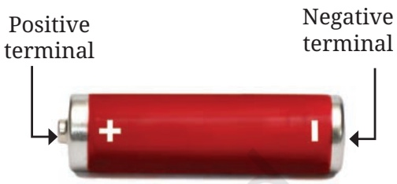
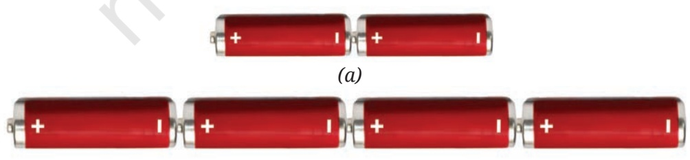

## 3.2 A Simple Electrical Circuit

To understand how a torch works, let us first find out about its components.

## 3.2.1 Electric cell

## Activity 3.2: Let us observe

Take an electric cell, turn it around and look at it carefully (Fig. 3.2). Do you notice a positive (+) sign and a negative (–) sign marked on the electric cell? Do you also notice that it has a small protruding metal cap on one side and a flat metal disc on the other side?

Fig. 3.2: An electric cell

All electric cells have two terminals; one is called positive (+ ve) while the other is negative (– ve). The metal cap is the **positive terminal** of the electric cell and the metal disc is the **negative terminal**. The electric cell is a portable source of electrical energy.

## 3.2.2 Battery

**Activity 3.3: Let us experiment** In a torch, we generally use more than one cell. Are those placed in any particular order?

Take a torch which uses two cells. Open its cell compartment and take out the cells.

Put the cells back in a different order. Also, try reversing the direction of one cell. Then, slide the switch and check whether the lamp glows in each case.

X Check the order in which the cells were placed in the torch when the lamp glows.

The lamp glows when the cells are placed in the order as shown in Fig. 3.3. Notice how the terminals of the two cells are connected. The positive terminal of one cell is connected to the negative terminal of the next cell. Such a combination of two or more cells is called a **battery**.

(b)

Fig. 3.3: A battery made up of (a) two cells (b) four cells