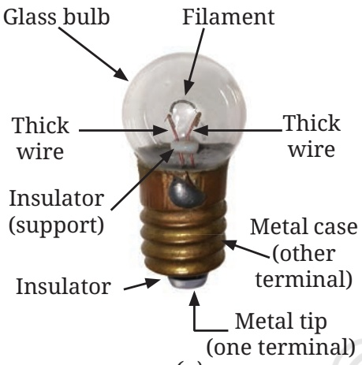
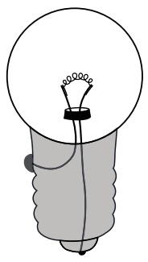

(b)

For many devices, we may need more than one cell. So, we connect two or more cells together as shown in Fig. 3.3. Connecting more than one cell provides energy to the circuit for a longer time and/or more energy.

## FASCINATING FACTS

The term battery is also used for a single cell. We use the term battery even for the single cell that powers our mobile phones.

## 3.2.3 Electric lamp

## Incandescent Lamp

## Activity 3.4: Let us observe

For this activity, you will require a torchlight with an incandescent lamp (or light bulb). Many old torchlights still use such lamps. With your teacher’s help, confirm that your torchlight uses an incandescent lamp.

Take the torch and **examine** its lamp. What do you see? Do you notice a thin wire fixed in the middle of the glass bulb?

Now, switch on the torch. Which part of the lamp glows?

The thin wire inside the glass bulb of the lamp glows. The glowing thin wire is called the **filament** of the lamp.

Take out the lamp with the help of your teacher and inspect it from all sides. How is the filament fixed?

The filament is attached to two thicker wires that support it, as shown in Fig. 3.4a. One thick wire connects to the metal case at the lamp’s base, while the other connects to the metal tip at the centre of the base (Fig. 3.4b). These form the two terminals of the lamp, and are fixed in a way that they do not touch each other. In such **incandescent lamps**, the filament gets hot and glows to produce light.

Fig. 3.4: (a) A small incandescent lamp used in a torch (b) its simplified drawing showing the connection of wires to the terminals

However, my torch has a different kind of lamp. In fact, it cannot be taken out of the torch as it is fixed in it.

