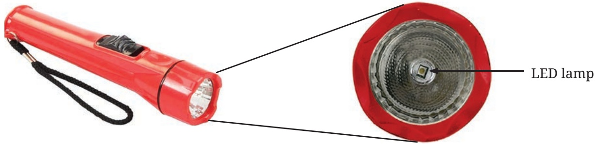
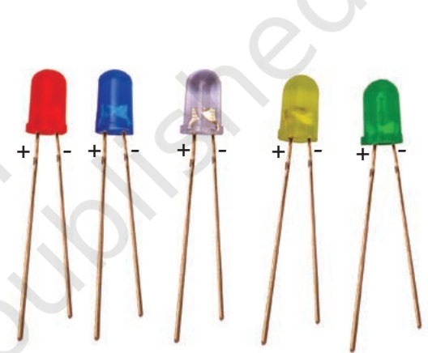

## LED Lamp

Many torches in use today have a Light Emitting Diode (LED) lamp, instead of an incandescent lamp, as shown in Fig. 3.5.

LED lamp

Fig. 3.5: An LED lamp for torch

## Activity 3.5: Let us observe

Take an LED of any colour (Fig. 3.6) and observe. Do you see any filament inside it?

**Notice** the length of two wires attached to the LED. Do you find one of those longer than the other?

Unlike incandescent lamps, LEDs do not have filaments (Fig. 3.6). They also have two terminals, but one is positive (attached to a longer wire) and the other is negative (the shorter wire). A torch may use one or more LEDs, sometimes of different shapes, in its lamp.

Fig. 3.6: LEDs of different colours

After having learnt about the electric cell, battery, and electric lamps, we are now ready to make the torch lamp glow using an electric cell or battery.

## 3.2.4 Making an electric lamp glow using an electric cell or battery

**Activity 3.6: Let us construct**

Take an electric cell, an incandescent lamp used in a torch, a cell holder, a lamp holder, and four lengths of electric wire.

Remove about 1 cm of the plastic covering from both ends of each wire to expose the metal.

Attach two wires to the two ends of the cell holder as shown in Fig. 3.7a.