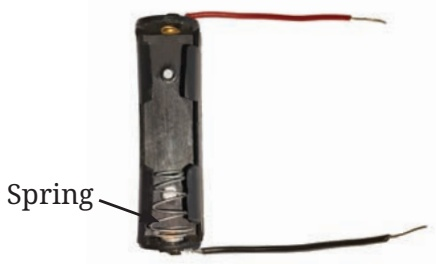
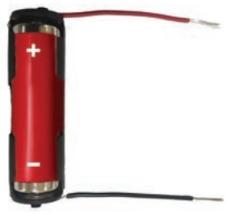
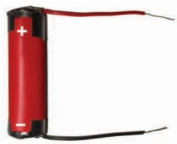
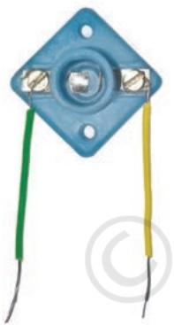
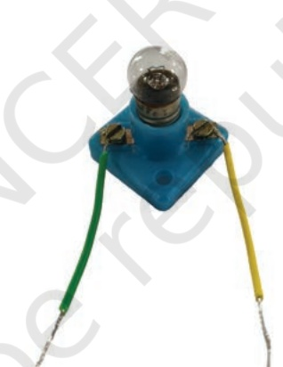
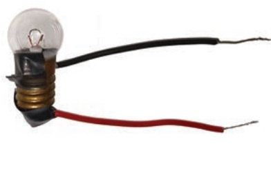

(a)

(b)

(c)

Fig. 3.7: (a) An electric cell holder with two wires attached (b) An electric cell inside the cell holder (c) Wires connected to an electric cell using electrical tape

Insert the cell in the holder such that its negative terminal is towards the spring side of the holder (Fig. 3.7b). In case a cell holder is not available, fix the two wires to the cell using electrical tape (Fig. 3.7c).

Attach two wires to the screws of the lamp holder as shown in Fig. 3.8a. Fix the lamp in the holder by turning it around in the holder (Fig. 3.8b). In case a lamp holder is not available, use electrical tape to attach two wires to the two ends of the lamp (Fig. 3.8c).

(a)

(b)

(c)

Fig. 3.8: (a) An electric lamp holder with wires attached (b) An incandescent lamp inside the lamp holder (c) Wires connected to incandescent torch lamp with electrical tape

Now, we are ready to connect the cell to the lamp to make it glow. We will conduct this activity in two parts — prediction and observation. Some of the ways in which the lamp and the cell can be connected are shown in Table 3.1.

**Predict**, for each arrangement, if the lamp will glow or not and write your prediction in Table 3.1.

Now, connect the lamp and the cell, and observe if the lamp glows or not. Note down your observation in Table 3.1. Also, for the lamps which glow, colour their glass bulbs yellow.

