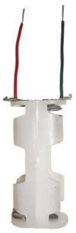
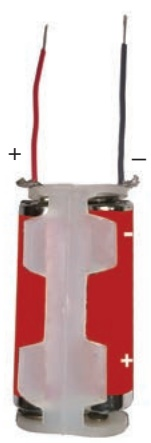
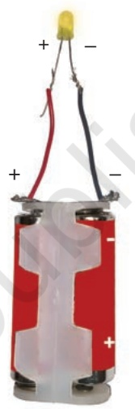
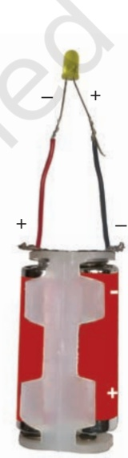
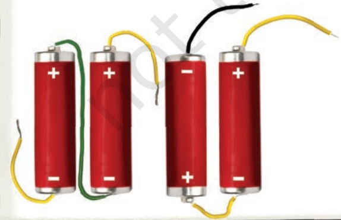

Insert two cells in the holder, taking care that for each cell, its negative terminal is towards the spring side of the holder (Fig. 3.10b) and the battery is ready to use. How will you decide which is the positive terminal of this battery?

The terminal of the holder which is connected to the positive terminal of one cell is positive and the one connected to the negative terminal of the other cell is the negative terminal.

Now, connect the free end of the battery positive terminal wire to the longer wire of LED, and the free end of the second wire to the shorter wire of LED (Fig. 3.10c). Does the LED glow?

Repeat the above step but interchange the wires connected to the LED (Fig. 3.10d). Does the LED glow again?

You would have observed that the LED glows in the first case (Fig. 3.10c) and does not glow in the other (Fig. 3.10d). It is because the current can pass through the LED in one direction only. The current passes through the LED only when the positive terminal (longer wire) of the LED is connected to the positive terminal of the battery, and negative terminal (shorter wire) of the LED is connected to the negative terminal of the battery. When current passes through the LED, it glows. Always take care to connect an LED correctly in a circuit to make it glow.

(a)

(b)

(c)

(d)

Fig. 3.10: Making an LED glow

Sometimes you may come across a device in which the cells are placedSometimes you may come across a device in which the cells are placed side by side. Then, how are the terminals of the cells connected?side by side. Then, how are the terminals of the cells connected?

If you carefully look inside If you carefully look inside the battery compartment, youthe battery compartment, youthe battery compartment, you will usually see a thick wirewill usually see a thick wire or metal strip connecting theor metal strip connecting the positive terminal of one cellpositive terminal of one cell to the negative terminal ofto the negative terminal of the next. To help with properthe next. To help with proper placement, ‘+’ and ‘–’ symbolsplacement, ‘+’ and ‘–’ symbols are typically printed inside.are typically printed inside.

