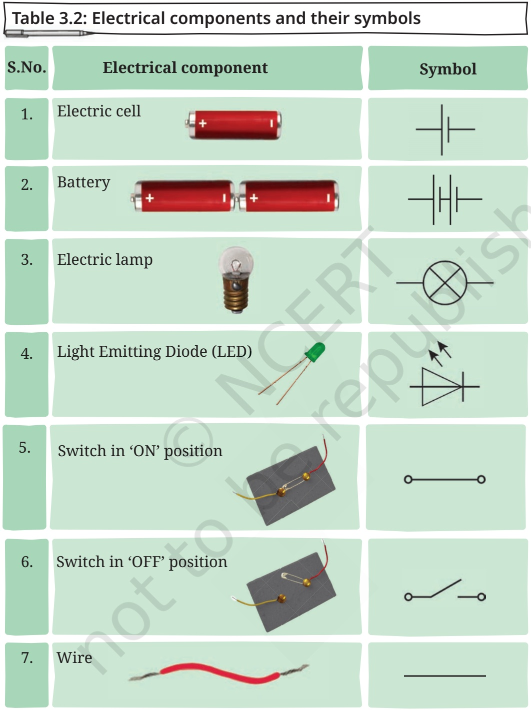

## 3.3 Circuit Diagrams

The various components of an electrical circuit can be represented by symbols shown in Table 3.2.

Can we represent the circuits in a simpler manner?

In the symbol for an electric cell, the long line represents the positive terminal, while the short line represents the negative terminal (Fig. 3.13a).