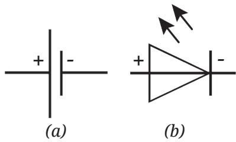
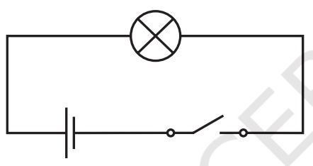
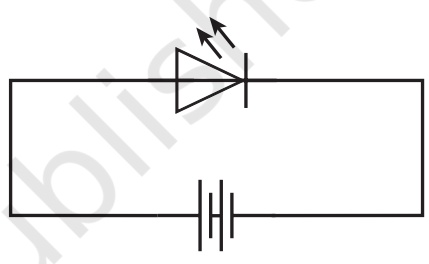

Fig. 3.13: Positive and negative terminals in the symbols of (a) a cell (b) an LED

In the symbol for an LED, the triangle points to the direction in which the current can flow. The two arrows indicate that an LED emits light (Fig. 3.13b).

By using symbols to represent electrical components, it is easier to draw and understand electrical circuits. A representation of an electrical circuit using symbols is called its **circuit diagram**.

## Activity 3.10: Let us draw

™ Using symbols shown in Table 3.2, **draw** the circuit diagram of an electrical circuit given in Fig. 3.12a and Fig. 3.10c.

Are your circuit diagrams similar to Fig. 3.14a and Fig. 3.14b respectively?

(a)

(b)

Fig. 3.14: A circuit diagram (a) with an incandescent lamp (b) with an LED lamp

## D eeper ive

International organisations, such as the International Electrotechnical Commission (IEC), American National Standards Institute (ANSI), and the Institute of Electrical and Electronics Engineers (IEEE) create standard symbols for electrical and electronic parts. Using the same symbols across the world helps people from different countries and industries understand each other easily.

## 3.4 Electrical Conductors and Insulators

Why did we use metal wires for making electric circuits? Can we not use some other materials for wires?

Also, why are electric wires covered with plastic or rubber?

