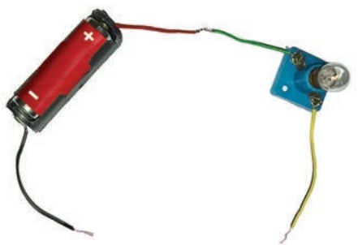
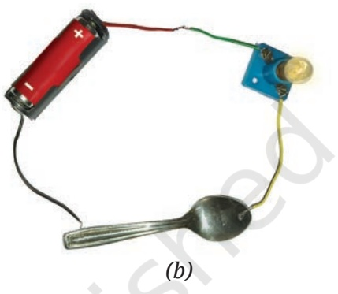

Suppose, we make wires of materials other than metal and use them for making the electrical circuit. Do you think the electric current will pass through those materials in such a circuit?

**Activity 3.11: Let us identify**

Connect an electric cell and a lamp while leaving the two ends of wires free as shown in Fig. 3.15a.

Touch the two free ends of the wires momentarily. Does the lamp glow? If yes, our tester is ready. We can use this tester to **identify** the materials through which electric current passes.

Collect objects of different materials, such as metal spoons, coins, cork, rubber, glass, keys, pins, plastic scale, wooden block, aluminium foil, candle, sewing needle, cardboard, paper, and pencil lead.

One by one, touch the free ends of the tester’s wires to both ends of each object you have collected (Fig. 3.15b). Make sure the wires don’t touch each other. Does the lamp glow every time?

(a)

Fig. 3.15: (a) Conduction tester (b) Using the conduction tester for testing a material

Record your observations in Table 3.3.

Table 3.3: Identifying Conductors and Insulators

<table><tr><td>S.No.</td><td>Object</td><td colspan=2>Material itis made upof</td><td>Lamp glows(Yes/No)</td><td>Conclusion(Conductor/Insulator)</td></tr><tr><td>1.</td><td>Stick</td><td colspan=2>Wood</td><td>No</td><td></td></tr><tr><td>2.</td><td>Scale</td><td colspan=2>Plastic</td><td></td><td></td></tr><tr><td>3.</td><td>Bangle</td><td colspan=2>Glass</td><td></td><td></td></tr><tr><td>4.</td><td>Paper strip</td><td colspan=2>Paper</td><td></td><td></td></tr><tr><td>5.</td><td>Candle</td><td colspan=2>Wax</td><td></td><td></td></tr><tr><td>6.</td><td>Key</td><td colspan=2>Metal</td><td></td><td></td></tr><tr><td>7.</td><td>Eraser</td><td colspan=2>Rubber</td><td></td><td></td></tr><tr><td>8.</td><td></td><td colspan=2></td><td></td><td></td></tr><tr><td>9.</td><td></td><td colspan=2></td><td></td><td></td></tr></table>