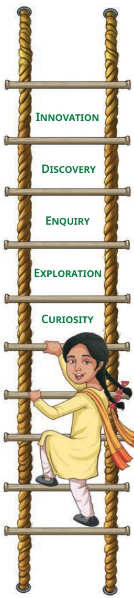
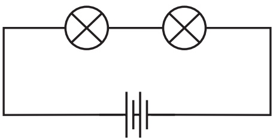
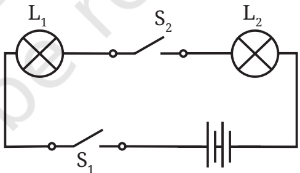
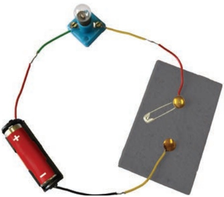

3. In Fig. 3.17, if the filament of one of the lamps is broken, will the other glow? Justify your answer.

Fig. 3.17

4. A student forgot to remove the insulator covering from the connecting wires while making a circuit. If the lamp and the cell are working properly, will the lamp glow?

5. Draw a circuit diagram for a simple torch using symbols for electric components.

6. In Fig. 3.18:

(i) If $\mathsf { S } _ { 2 }$ is in ‘ON’ position, $\mathsf { S } _ { 1 }$ is in ‘OFF’ position, which lamp(s) will glow?

(ii) If $\mathsf { S } _ { 2 }$ is in ‘OFF’ position, $\mathsf { S } _ { 1 }$ is in ‘ON’ position, which lamp(s) will glow?

(iii) If $\mathsf { S } _ { 1 }$ and $\mathsf{S}_{2}$ both are in ‘ON’ position, which lamp(s) will glow?

(iv) If both $\mathbb { S } _ { 1 }$ and $\mathsf { S } _ { 2 }$ are in ‘OFF’ position, which lamp(s) will glow?

Fig. 3.18

7. Vidyut has made the circuit as shown in Fig. 3.19. Even after closing the circuit, the lamp does not glow. What can be the possible reasons? List as many possible reasons as you can for this faulty operation. What will you do to find out why the lamp did not glow?

Fig. 3.19