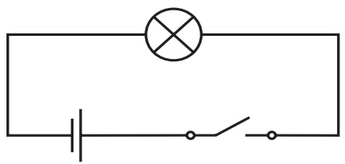
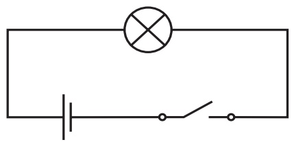
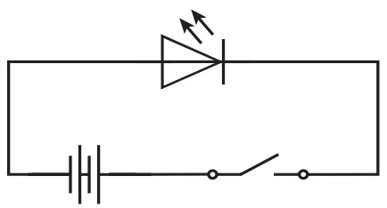
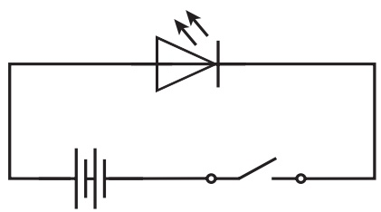
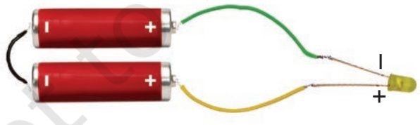
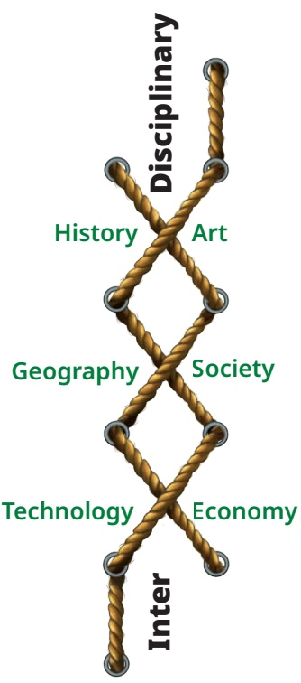

8. In Fig. 3.20, in which case(s) the lamp/LED will not glow when the switch is closed?

(a)

(b)

(c)

Fig. 3.20

(d)

9. Suppose the ‘+’ and ‘–’ symbols cannot be read on a battery. Suggest a method to identify the two terminals of this battery.

10. You are given six cells marked $\mathrm { A } _ { i }$ B, C, D, E, and F. Some of these are working and some are not. Design an activity to identify which of them are working.

(i) List the items that you require.

(ii) Write the procedure that you will follow.

(iii) With the items, carry out the activity to identify the cells that are working.

11. Using an LED that requires two cells in series to glow, Tanya made the circuit as shown in Fig. 3.21. Will the lamp glow? If not, draw the wires for correct connections.

Fig. 3.21

## Exploratory Projects

™ Suppose that due to some problem, the power supply is disrupted in your area for two days. List out which actions from your daily life you would not be able to do.

