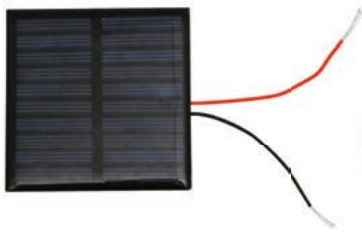
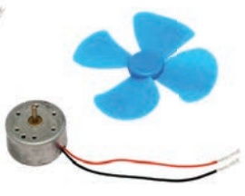
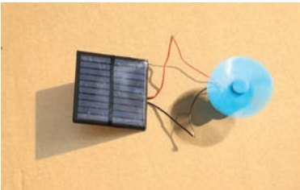
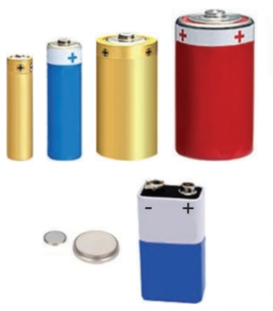
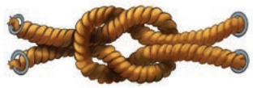

Using a solar panel (Fig. 3.22a) as a source of electrical energy, make a circuit to run a toy fan (Fig. 3.22b) as shown in Fig. 3.22c.

(a)

(b)

Fig. 3.22

(c)

Visit an electrical items shop. With the help of the shopkeeper, identify the various types of cells available. For each cell, also find out which device(s) it is used for. Prepare a report.

Prepare a list of objects in your home under three categories:

(i) Objects which are electrical insulators only

(ii) Objects which are electrical conductors only

(iii) Objects which are made of both, whose some parts are insulators and some electrical conductors

## SCIENCE AND SOCIETY

Electric cells or batteries are compact portable sources of electrical energy that make the use of some electrical devices more convenient. These cells and batteries come in various shapes and sizes for different purposes, such as cylindrical batteries for torchlights, clocks, remotes, toys; button cells for watches, hearing aids; rechargeable batteries for mobile phones, laptops, and electric vehicles.

