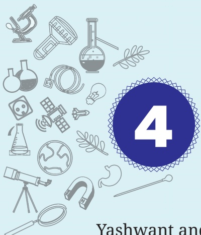
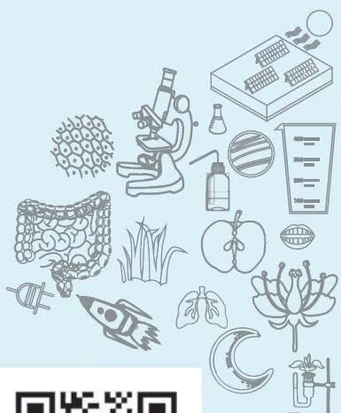
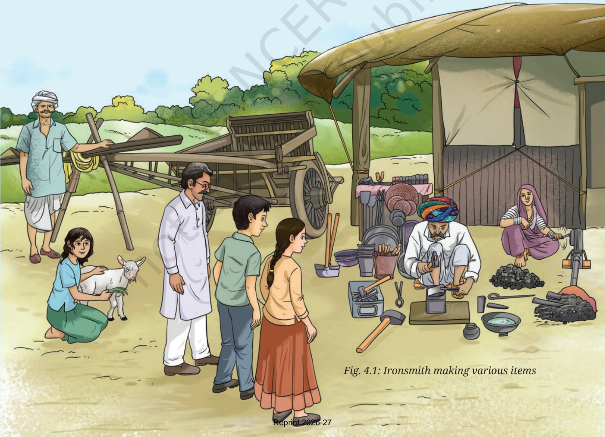

# The World of Metals and Non-metals

Yashwant and Anandi live in a village in Rajasthan. Their school has assigned them a project to learn about craftspersons who work with metals. They decide to visit the local ironsmiths who practise this craft. Yashwant and Anandi request their grandfather to accompany them (Fig. 4.1). They are curious to learn how these ironsmiths make different items of daily use. They interact with an elderly craftsperson, Sudarshan uncle.

0777CH04

Yashwant: Which items do you generally make?

Sudarshan: Generally, we make items of daily use, such as flat pans (tawas), buckets (baltis), tongs (chimtas), and farming tools like spades (phawras), axes (kulhadis), trowels (khurpis), and rakes (jelees).

Anandi: What materials are they made of?

Fig. 4.1: Ironsmith making various items