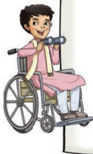

A piece of coal or a lump of sulfur does not show this behaviour. They break into pieces and are said to be **brittle**. On the other hand, wood neither gets flattened into a sheet nor breaks into pieces. Therefore, wood is neither malleable nor brittle.

## HOLISTIC LENS

## The impact of iron on the progress of civilisation of India

In the Grade 6 Social Science textbook Exploring Society India and Beyond, you learnt about the Harappans. They knew how to use metals like copper and gold. They used these metals to make various objects, from utensils to jewellery. However, you would hardly find any evidence of the Harappans using a very prominent metal iron, which you see a lot around you today. This is because it took a longwhich you see a lot around you today. This is because it took a long time before iron was used in day-to-day activities.time before iron was used in day-to-day activities.

However, once the use of iron gained prominence in the times thatHowever, once the use of iron gained prominence in the times that followed, it contributed significantly to the progress of civilisation infollowed, it contributed significantly to the progress of civilisation in India. For instance, due to its strength, agricultural tools like ploughsIndia. For instance, due to its strength, agricultural tools like ploughs made from iron were much superior to those used previously.made from iron were much superior to those used previously.

What could be the potential reason that it is generally consideredWhat could be the potential reason that it is generally considered that copper was discovered earlier as compared to iron?that copper was discovered earlier as compared to iron?

## 4.1.2 Ductility

Where do you find the use of metal wires?

You might have seen wires of metals like copper or aluminium in electrical fittings. Some ornaments, like bangles, necklaces, earrings, etc., are also made from metal wires. Metal wires play important functions in a variety of stringed musical instruments, such as veena, sitar, violin, and guitar.

This property of materials by which they can be drawn into wires is called **ductility**.

This property of ductility is mainly possessed by metals.

Gold is so ductile that one gram of it can be drawn into a 2 kilometre-long wire!

The ductile nature of metals enables for the creation of this tea strainer with metal wire.

